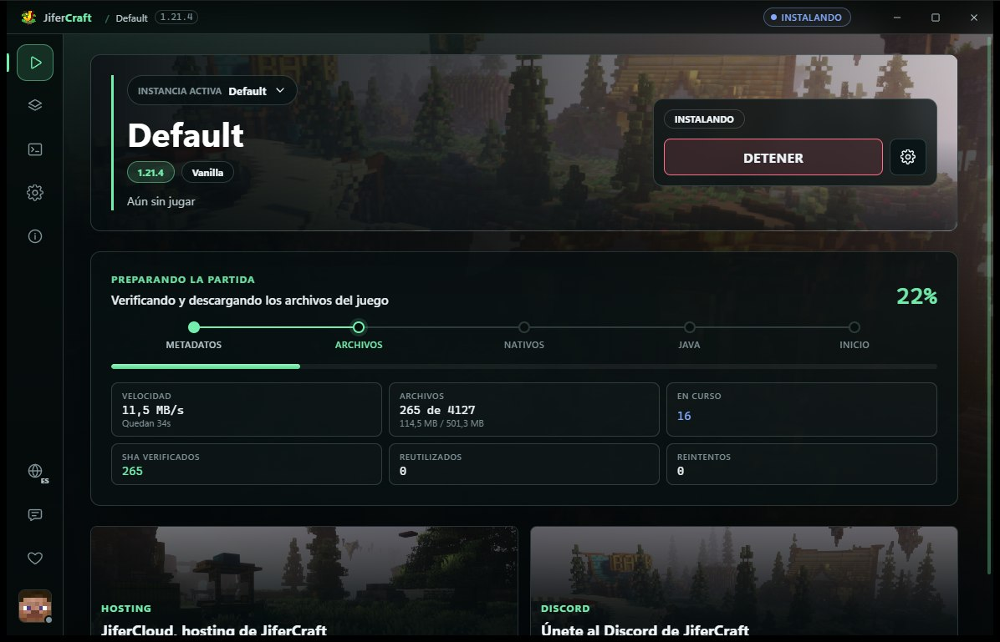
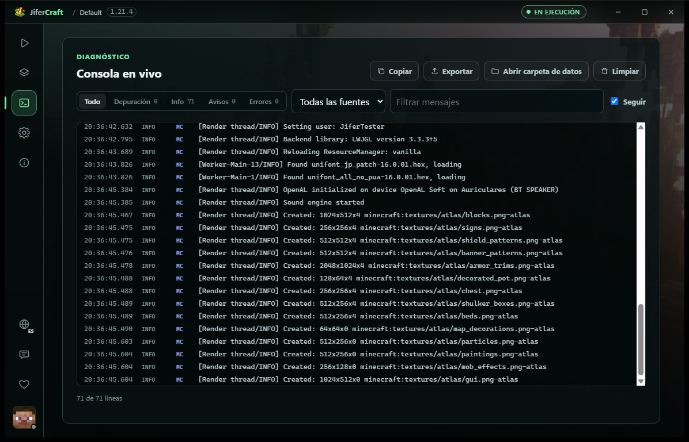

# JiferCraft Launcher

Launcher de Minecraft para Windows enfocado en abrir el juego al instante sin devorarte la memoria RAM ni romper descargas a mitad de camino.

La versión anterior estaba montada en Electron, pero tener un Chromium entero consumiendo ~400 MB de memoria solo para hacer clic en "Jugar" no tenía sentido. Esta versión rehace el motor desde cero en **Rust** (estructurado en crates modulares) y utiliza **React** sobre **Tauri v2**, aprovechando el WebView2 nativo de Windows (~24 MB instalados).



### De Electron a Rust + Tauri v2

| Métrica (Windows 11) | Prototipo anterior (Electron) | Versión actual (Rust + Tauri v2) |
| :--- | :--- | :--- |
| **Instalador** | 107,4 MB | **10,6 MB** (-90%) |
| **Instalado en disco** | 365 MB (`win-unpacked`) | **24 MB** (reutiliza WebView2 del sistema) |
| **Tiempo de arranque** | ~3,8 segundos | **< 400 ms** (instantáneo) |

---

## Qué resuelve tras bambalinas

* **Descargas a prueba de conexiones inestables**: Cada librería, asset y binario de Mojang se baja en paralelo a un archivo temporal `.part`. El launcher verifica el hash SHA-1 o SHA-256 en tiempo real, ejecuta `fsync` a disco y recién ahí lo renombra de forma atómica. Si se corta internet a mitad de camino, no te deja la instalación rota ni archivos a medio escribir.
* **Java automático y sin líos**: Analiza qué runtime pide la versión que vas a jugar (Java 8 para 1.12.2, 17 para 1.20, 21 para 1.21...) y descarga la compilación oficial de **Eclipse Temurin** (Adoptium) extrayéndola con protección contra *zip-slip*. No tienes que configurar variables de entorno ni instalar JDKs a mano.
* **Instancias aisladas**: Cada perfil o modpack tiene su propia carpeta para mundos, mods y opciones. Además, mientras el juego está abierto se mantiene un bloqueo de archivo a nivel de sistema operativo para que no abras la misma partida dos veces por error ni se pisen configuraciones.
* **Aviso de carpetas en OneDrive**: Si detecta que intentas guardar una instancia dentro de una carpeta sincronizada por OneDrive, te avisa. OneDrive intentando subir archivos de región mientras Minecraft escribe chunks en caliente es la causa principal de mundos corrompidos.
* **Inicio de sesión**:
  * **Microsoft**: Vía *Device Code Flow* oficial. Inicias sesión en tu navegador sin meter contraseñas en el launcher, y el token de refresco se guarda protegido en el Administrador de Credenciales de Windows (keyring del sistema).
  * **Modo Offline**: Con generación de UUIDs deterministas para mantener skins e inventarios consistentes en partidas locales.
* **Consola legible**: Parsea en vivo el XML crudo (`LegacyXMLLayout`) que emite Minecraft para mostrar un log limpio con filtros de severidad (`INFO`, `WARN`, `ERROR`) y exportación rápida a `.log` por si necesitas pedir ayuda en soporte.



---

## Dónde se guardan los datos

El launcher guarda sus perfiles, configuraciones y versiones de Minecraft en:

```text
%APPDATA%\.jifercloud\
├── settings.json       # Configuración global del launcher
├── instances\          # Perfiles independientes (mundos, mods y configs)
├── runtimes\           # JREs descargados (Java 8, 17, 21 de Adoptium)
├── cache\              # Assets, librerías y metadatos cacheados
└── logs\               # Registros del launcher y salidas de consola
```

> Si quieres probar cambios sin tocar tus datos reales, puedes definir la variable de entorno `JIFERCRAFT_DATA_DIR` apuntando a otra carpeta.

---

## Estructura del repositorio

El backend está dividido en crates dentro de `crates/`:

```text
mc-launcher/
├── apps/
│   └── desktop/                 # Shell de Tauri v2 + Interfaz en React 19 + TypeScript + Vite
├── crates/
│   ├── jifercraft-core/         # Lógica de perfiles, instancias, versiones y ejecución de procesos
│   ├── jifercraft-net/          # Descargador HTTP concurrente en streaming con validación de hashes
│   ├── jifercraft-auth/         # Autenticación Microsoft (OAuth / Xbox Live) y sesiones offline
│   └── jifercraft-updater/      # Actualizador automático firmado con Ed25519 (minisign)
├── Cargo.toml                   # Workspace de Rust
└── package.json                 # Scripts de orquestación con Bun
```

---

## Compilación y desarrollo local

### Requisitos previos
* **Rust** (versión estable con toolchain MSVC en Windows).
* **Bun** (para dependencias y scripts de frontend).
* **Tauri CLI**: `cargo install tauri-cli --version "^2.0" --locked`
* **WebView2** (incluido por defecto en Windows 10 y 11).

### Comandos de desarrollo

```bash
# 1. Instalar dependencias del frontend
bun install

# 2. Iniciar el launcher en modo desarrollo (recarga rápida de frontend y Rust)
bun run dev

# 3. Pasar las comprobaciones de Rust (clippy, formato y tests)
bun run check:rust

# 4. Comprobaciones de frontend (tipos y tests)
bun run typecheck
bun run test

# 5. Compilar el instalador para producción
bun run build
```

Para probar el inicio de sesión con Microsoft en local, copia `.env.example` a `.env` y configura tu `MICROSOFT_CLIENT_ID`. En modo offline no hace falta configurar nada.

---

## Soporte y reporte de errores

Si encuentras algún problema o bug:
1. Abre un issue en [GitHub Issues](https://github.com/JainaGam3r45/Jifer-Launcher/issues).
2. Desde la consola del launcher dale a **Exportar registro** y adjunta el archivo `.log` generado (los tokens y datos personales se omiten automáticamente).
3. O date una vuelta por nuestra web en [jifercraft.com](https://www.jifercraft.com/).

---

## Licencia

Distribuido bajo licencia Apache 2.0. Consulta [LICENSE](./LICENSE) y [NOTICE](./NOTICE) para más detalles.
